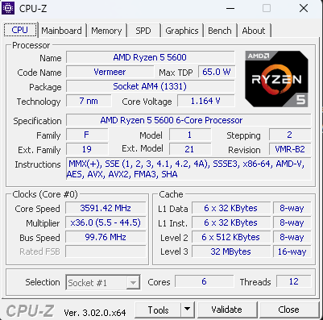
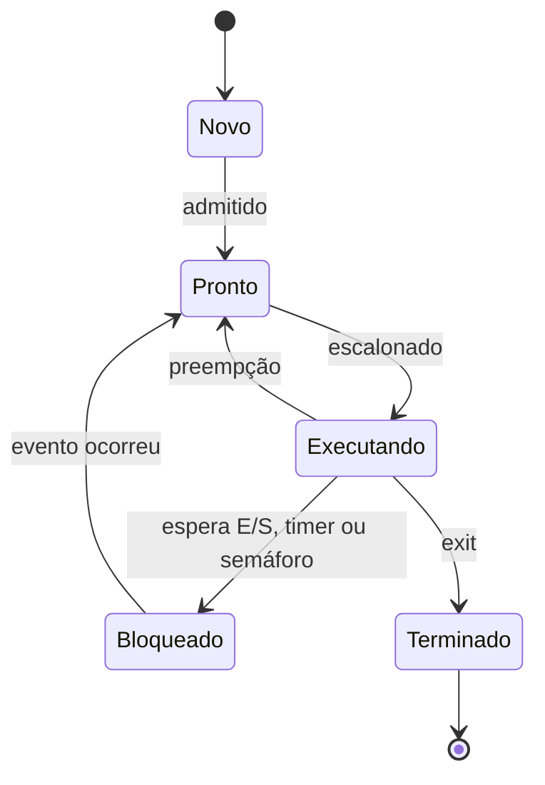
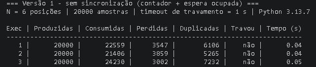
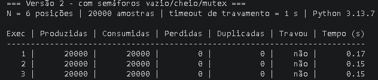
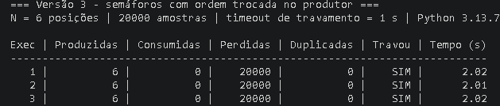
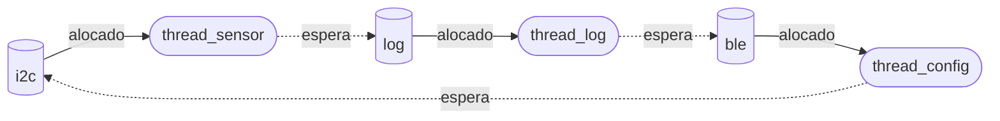

Bernardo Laurindo Gonzaga | D1 = 8 | D2 = 3 | N = 6

# Ponderada CC08: do pipeline ao deadlock

## Parâmetros

Nome: Bernardo (8) + Laurindo (8) + Gonzaga (7) = 23 letras.

- D1 = 8 (letras de "Bernardo")
- D2 = 3 (último dígito de 23)
- IC = 100.000 + 20.000 × 3 = 160.000 instruções por amostra
- m = 3% + 0,5% × 8 = 7% = 0,07
- N = 3 + (3 mod 5) = 6

O requisito é processar cada amostra em até 5 ms.

---

# Parte A: o problema técnico

## A1. Arquitetura e memória

### Plataforma H

A SRAM responde em 1 ciclo e não tem cache, então não existe falta e o CPI é o próprio 1,5.

```
ciclos = IC × CPI = 160.000 × 1,5 = 240.000 ciclos
tempo  = 240.000 / 48.000.000 = 0,005 s = 5,00 ms
```

Atende, mas no limite: 5,00 ms é exatamente o máximo permitido, sem nenhuma margem. Se o firmware ganhar qualquer instrução a mais, deixa de atender. Como não tem sistema operacional, esse tempo é sempre o mesmo, ou seja, o pior caso é igual ao caso médio.

### Plataforma V

AMAT:

```
AMAT = acerto + m × penalidade
     = 1 + 0,07 × 120
     = 9,4 ciclos   (≈ 7,83 ns com ciclo de 0,833 ns)
```

CPI efetivo:

```
CPI_ef = 1,0 + (1,3 × 0,07 × 120)
       = 1,0 + 10,92
       = 11,92
```

Ou seja, de cada 11,92 ciclos, 10,92 são o processador parado esperando a memória.

Tempo por amostra e pior caso:

```
ciclos     = 160.000 × 11,92 = 1.907.200
tempo      = 1.907.200 / 1.200.000.000 = 1,589 ms
pior caso  = 1,589 + 3 = 4,589 ms
```

Atende: 4,59 ms < 5 ms, com 0,41 ms de folga (8%). A média é boa, mas o que preocupa é o pior caso, e quem empurra ele para perto do limite são os 3 ms do Linux.

### Plataforma H com DSP (Amdahl)

O filtro é 60% do tempo (f = 0,6) e fica 5 vezes mais rápido (s = 5).

```
speedup = 1 / ((1 − f) + f/s)
        = 1 / (0,4 + 0,6/5)
        = 1 / 0,52
        ≈ 1,92

novo tempo = 5,00 / 1,92 = 2,60 ms
(conferindo: 0,4 × 5 + 0,6 × 5 / 5 = 2,0 + 0,6 = 2,6 ms)
```

Agora atende com folga: sobram 2,4 ms. O ganho total é só 1,92× mesmo com o filtro 5× mais rápido, porque os 40% que não são filtro continuam iguais e viram a maior parte do tempo (2,0 de 2,6 ms).

| Plataforma | Tempo | Pior caso | Folga | Atende? |
|---|---|---|---|---|
| H | 5,00 ms | 5,00 ms | 0 | sim, no limite |
| V | 1,59 ms | 4,59 ms | 0,41 ms | sim |
| H + DSP | 2,60 ms | 2,60 ms | 2,40 ms | sim |

### Por que a V precisa de cache e a H não

Na V, instrução e dado passam pelo mesmo barramento até uma DRAM que demora 120 ciclos. Esse é o gargalo de Von Neumann. Sem cache, com 1,3 acessos por instrução, o CPI ficaria perto de 1 + 1,3 × 120 ≈ 157, e o clock de 1,2 GHz não serviria de nada. Na H (Harvard), instrução e dado têm barramentos separados e vão para uma SRAM interna de 1 ciclo. Como o processador é lento (48 MHz), a memória acompanha e não há gargalo para esconder.

### Caches do meu computador



Meu processador é um AMD Ryzen 5 5600 (6 núcleos, 12 threads). O print é do CPU-Z 3.02, no quadro Cache da aba CPU:

- L1 Data: 6 x 32 KB (8-way), uma por núcleo
- L1 Inst.: 6 x 32 KB (8-way), uma por núcleo
- Level 2: 6 x 512 KB (8-way), unificada, uma por núcleo
- Level 3: 32 MB (16-way), unificada e compartilhada entre os núcleos

A L1 é dividida em instruções e dados, mas o computador continua sendo Von Neumann. A separação só existe dentro do núcleo, na L1. A L2, a L3 e a RAM são unificadas, e programa e dados ficam no mesmo espaço de endereçamento (é assim que o sistema operacional carrega um executável: lendo o código como se fosse dado). Isso costuma ser chamado de Harvard modificada: o núcleo consegue buscar instrução e dado ao mesmo tempo, como no Harvard, mas a memória que o programa enxerga é Von Neumann.

---

## A2. Pipeline

```
1  lw   x5, 0(x10)
2  add  x6, x6, x5
3  lw   x7, 0(x11)
4  sub  x6, x6, x7
5  sw   x6, 0(x12)
6  addi x10, x10, 4
7  addi x11, x11, 4
```

### Dependências RAW

- 2 depende de 1 por x5 (o add usa o valor carregado pelo lw logo antes)
- 4 depende de 2 por x6
- 4 depende de 3 por x7 (o sub usa o valor carregado pelo lw logo antes)
- 5 depende de 4 por x6

As instruções 6 e 7 só escrevem x10 e x11 depois de 1 e 3 já terem lido esses registradores. Isso é WAR, que não gera bolha num pipeline em ordem.

### Sem forwarding

Como o banco escreve na primeira metade do ciclo e lê na segunda, a instrução dependente pode fazer o ID no mesmo ciclo do WB da que produz o valor. Com distância 1 isso dá 2 bolhas. Com distância 2 dá 1 bolha.

Ficam 2 bolhas em 1→2, 2 em 3→4 (que já cobrem a dependência 2→4) e 2 em 4→5. São 6 bolhas no total. Na tabela, `st` é bolha.

| | 1 | 2 | 3 | 4 | 5 | 6 | 7 | 8 | 9 | 10 | 11 | 12 | 13 | 14 | 15 | 16 | 17 |
|---|---|---|---|---|---|---|---|---|---|---|---|---|---|---|---|---|---|
| 1 lw | IF | ID | EX | MEM | WB | | | | | | | | | | | | |
| 2 add | | IF | st | st | ID | EX | MEM | WB | | | | | | | | | |
| 3 lw | | | IF | st | st | ID | EX | MEM | WB | | | | | | | | |
| 4 sub | | | | | | IF | st | st | ID | EX | MEM | WB | | | | | |
| 5 sw | | | | | | | IF | st | st | st | st | ID | EX | MEM | WB | | |
| 6 addi | | | | | | | | | | IF | st | st | ID | EX | MEM | WB | |
| 7 addi | | | | | | | | | | | | | IF | ID | EX | MEM | WB |

Total: 17 ciclos (o ideal seria 5 + 7 − 1 = 11, mais as 6 bolhas).

### Com forwarding

Com forwarding, as dependências entre instruções de ALU deixam de parar o pipeline. Só sobra o caso do load seguido de uso, que acontece em 1→2 e 3→4, com 1 bolha cada.

| | 1 | 2 | 3 | 4 | 5 | 6 | 7 | 8 | 9 | 10 | 11 | 12 | 13 |
|---|---|---|---|---|---|---|---|---|---|---|---|---|---|
| 1 lw | IF | ID | EX | MEM | WB | | | | | | | | |
| 2 add | | IF | ID | st | EX | MEM | WB | | | | | | |
| 3 lw | | | IF | st | ID | EX | MEM | WB | | | | | |
| 4 sub | | | | | IF | ID | st | EX | MEM | WB | | | |
| 5 sw | | | | | | IF | st | ID | EX | MEM | WB | | |
| 6 addi | | | | | | | | IF | ID | EX | MEM | WB | |
| 7 addi | | | | | | | | | IF | ID | EX | MEM | WB |

Total: 13 ciclos.

As dependências que continuam dando bolha são as dos loads: x5 de 1 para 2 e x7 de 3 para 4. O lw só tem o dado no fim do MEM, e a instrução de trás precisaria dele no começo do EX, no mesmo ciclo. O forwarding não consegue entregar um dado que ainda não existe, então ela espera 1 ciclo e recebe o valor pelo caminho MEM/WB→EX.

### Reordenando

A ideia é colocar os dois loads no começo, assim cada um fica a duas instruções de distância de quem usa o valor:

```
lw   x5, 0(x10)
lw   x7, 0(x11)
add  x6, x6, x5     # x5 chega por MEM/WB -> EX
sub  x6, x6, x7     # x7 por MEM/WB -> EX, x6 por EX/MEM -> EX
sw   x6, 0(x12)
addi x10, x10, 4
addi x11, x11, 4
```

O resultado é o mesmo, porque os dois lw ainda leem x10 e x11 antes dos addi, e o sw continua depois dos dois loads.

| | 1 | 2 | 3 | 4 | 5 | 6 | 7 | 8 | 9 | 10 | 11 |
|---|---|---|---|---|---|---|---|---|---|---|---|
| lw x5 | IF | ID | EX | MEM | WB | | | | | | |
| lw x7 | | IF | ID | EX | MEM | WB | | | | | |
| add | | | IF | ID | EX | MEM | WB | | | | |
| sub | | | | IF | ID | EX | MEM | WB | | | |
| sw | | | | | IF | ID | EX | MEM | WB | | |
| addi x10 | | | | | | IF | ID | EX | MEM | WB | |
| addi x11 | | | | | | | IF | ID | EX | MEM | WB |

Total: 11 ciclos, sem nenhuma bolha. Resumindo: 17 ciclos sem forwarding, 13 com forwarding e 11 com forwarding e reordenação.

---

## A3. Processos e threads

### Organização

Eu dividiria o software em dois processos:

- **Processo principal (prioridade de tempo real):** três threads, uma para o sensor, uma para o processamento e uma para o motor. Elas conversam pelo buffer circular protegido por semáforos.
- **Processo do BLE (prioridade normal, sem privilégios):** uma thread que manda o log para o celular e recebe os comandos de configuração. Ele conversa com o principal por IPC (um socket local ou uma fila de mensagens de tamanho fixo).

Sensor, processamento e motor ficam como threads porque formam o caminho crítico dos 5 ms e mexem nos mesmos dados a cada 10 ms. Como threads, compartilham memória sem precisar copiar nada, e a troca de contexto é barata porque o espaço de endereçamento não muda (não precisa trocar tabela de páginas nem limpar TLB). Isolar uma da outra também não traria vantagem: se qualquer uma delas cair, a pulseira já parou de funcionar.

O BLE fica num processo separado porque não está no caminho crítico (o log pode atrasar alguns milissegundos sem problema), recebe dados de fora e usa uma pilha de rádio grande, onde é mais provável aparecer bug. O custo de ser processo é pequeno: ele é criado uma vez só, no boot, e troca poucas mensagens por segundo. Em troca, se a pilha BLE travar ou der segfault, só esse processo morre. O sistema reinicia ele e a pulseira continua vibrando. Se o BLE fosse uma thread, a falha derrubaria o processo inteiro, motor junto.

### Se alguém explorar uma falha no BLE

Se o BLE for uma thread, quem explorar a falha passa a rodar código dentro do mesmo espaço de memória do processo principal. Aí dá para mexer no buffer de amostras, mudar o limiar de distância, desligar o motor ou fazê-lo vibrar à toa. O sistema operacional não tem como bloquear isso, porque para ele é tudo o mesmo processo. Para alguém que depende da vibração para não bater num poste, isso é um risco físico.

Se o BLE for um processo, o atacante fica preso na memória dele, e a MMU não deixa acessar a memória do processo principal. Só sobra o canal de IPC. Se esse canal só aceitar mensagens de formato fixo e com valores checados (por exemplo, limiar entre 20 e 400 cm), e o processo BLE rodar sem permissão de acessar o GPIO do motor e o I2C do sensor, o máximo que o atacante consegue é parar o log ou mandar uma configuração válida. Para ir além, ele precisaria achar uma segunda falha.

### Diagrama de estados



A thread do sensor passa a maior parte do tempo em **Bloqueado**. Ela acorda a cada 10 ms pelo timer, faz a leitura no I2C (que também é E/S, então ela bloqueia de novo por alguns microssegundos), coloca a amostra no buffer e volta a dormir. Esse trabalho é bem menor que 1 ms. Mesmo que ela fizesse o processamento inteiro, que leva 1,59 ms pela A1, ainda ficaria mais de 80% de cada janela de 10 ms esperando. É uma tarefa periódica e limitada por E/S, não por CPU.

---

## A4. Semáforos: buffer entre sensor e motor

O código está em [codigo/](codigo/), em Python com `threading`, usando N = 6 e 20.000 amostras. Se o consumidor passar 1 s sem receber nada, a execução conta como travamento.

- `comum.py`: parâmetros, contagem e laço que roda cada versão 3 vezes
- `versao1.py`: sem sincronização, usando um contador `ocupadas`, espera ocupada e `time.sleep(0)` entre ler e escrever o contador
- `versao2.py`: semáforos `vazio` (começa em 6), `cheio` (começa em 0) e `mutex` (começa em 1)
- `versao3.py`: igual à 2, mas o produtor faz P(mutex) antes de P(vazio)

Como contei cada coluna:

- **Consumidas:** quantas leituras o motor fez, contando repetições.
- **Duplicadas:** leituras de uma amostra que já tinha sido lida.
- **Perdidas:** números de 0 a 19.999 que o motor nunca recebeu.

### Resultados

| Versão | Exec | Consumidas | Perdidas | Duplicadas | Travou |
|---|---|---|---|---|---|
| 1 | 1 | 22.559 | 3.547 | 6.106 | não |
| 1 | 2 | 21.406 | 3.859 | 5.265 | não |
| 1 | 3 | 24.230 | 3.002 | 7.232 | não |
| 2 | 1 | 20.000 | 0 | 0 | não |
| 2 | 2 | 20.000 | 0 | 0 | não |
| 2 | 3 | 20.000 | 0 | 0 | não |
| 3 | 1 | 0 | 20.000 | 0 | sim |
| 3 | 2 | 0 | 20.000 | 0 | sim |
| 3 | 3 | 0 | 20.000 | 0 | sim |

Na versão 3, o produtor chegou a colocar 6 amostras no buffer antes de travar, mas o motor nunca leu nenhuma, então as 20.000 contam como perdidas.

### Prints

Versão 1:



Versão 2:



Versão 3:



As saídas em texto estão em [img/saida-versao1.txt](img/saida-versao1.txt), [img/saida-versao2.txt](img/saida-versao2.txt) e [img/saida-versao3.txt](img/saida-versao3.txt).

### Região crítica da versão 1

A região crítica é o trecho que lê o contador, calcula o novo valor e grava de volta (`tmp = ocupadas; sleep(0); ocupadas = tmp ± 1`), junto com o acesso ao buffer que depende desse valor. Como nada impede as duas threads de estarem nele ao mesmo tempo, acontece isto:

1. O produtor lê `ocupadas = 3` e é interrompido no `sleep(0)`.
2. O consumidor lê 3, consome uma amostra e grava 2.
3. O produtor volta e grava 3 + 1 = 4. O decremento do consumidor se perdeu.

A partir daí o contador não bate mais com o que está no buffer. Quando ele fica abaixo do real, o produtor acha que tem espaço e escreve por cima de amostras que o motor ainda não leu, e essas amostras são perdidas. Quando fica acima do real, o motor acha que tem amostra nova e lê de novo uma posição antiga, o que gera duplicatas. Por isso cada execução deu um número diferente: o resultado depende de onde o escalonador interrompe as threads. Na pulseira, a amostra perdida pode ser justamente a que mostrava o poste.

### Os três semáforos da versão 2

- **vazio (começa em N):** conta as posições livres. O produtor faz P(vazio) antes de escrever, então nunca escreve com o buffer cheio e não apaga amostra que ainda não foi lida. Isso garante zero perdas.
- **cheio (começa em 0):** conta as posições ocupadas. O motor faz P(cheio) antes de ler, então nunca lê com o buffer vazio e não relê posição velha. Isso garante zero duplicatas. Além disso, o motor dorme enquanto espera, em vez de ficar gastando CPU em espera ocupada.
- **mutex (começa em 1):** garante que só uma thread por vez mexe no buffer, nos índices e no contador. Com isso o "ler, alterar e gravar" vira atômico, e o `sleep(0)` no meio já não causa problema.

### O que aconteceu na versão 3

Ela travou nas três execuções, logo que o buffer encheu.

1. O produtor é mais rápido e enche as 6 posições, deixando `vazio` em 0.
2. Na sétima amostra, ele faz P(mutex), que passa, e depois P(vazio), que bloqueia. Ele fica dormindo segurando o mutex.
3. O motor faz P(cheio), que passa porque há 6 amostras, e depois P(mutex), que bloqueia porque o produtor está com o mutex.
4. O produtor só acorda quando o motor fizer V(vazio). O motor só faz isso depois de pegar o mutex. E o mutex só é liberado quando o produtor acordar.

Um espera pelo outro e nenhum avança: é um deadlock. O programa só termina porque o consumidor usa `acquire` com timeout de 1 s. Na pulseira, o motor simplesmente pararia de vibrar. A regra que fica é não esperar num semáforo de contagem (`vazio`) segurando o mutex.

---

## A5. Deadlock

### Sequência que trava

1. thread_sensor faz P(i2c) e lê o sensor. Agora ela tem o i2c.
2. Troca de contexto. thread_log faz P(log) e lê o log. Ela tem o log.
3. Troca de contexto. thread_config faz P(ble) e recebe o comando. Ela tem o ble.
4. thread_sensor faz P(log) e bloqueia, porque o log está com thread_log.
5. thread_log faz P(ble) e bloqueia, porque o ble está com thread_config.
6. thread_config faz P(i2c) e bloqueia, porque o i2c está com thread_sensor.

As três ficam paradas esperando e nenhuma solta o que tem. A pulseira só volta quando alguém desliga e liga de novo.

### Grafo de alocação

No grafo, a seta cheia do recurso para a thread quer dizer que o recurso está alocado a ela. A tracejada da thread para o recurso quer dizer que ela está esperando por ele.



Tem um ciclo: sensor → log → thread_log → ble → thread_config → i2c → sensor. Como cada recurso tem uma instância só, ter um ciclo já basta para ser deadlock.

### As quatro condições

- **Exclusão mútua:** i2c, log e ble são semáforos binários, então só uma thread por vez usa cada recurso.
- **Posse e espera:** cada thread pede o segundo recurso sem largar o primeiro. O sensor segura o i2c e pede o log, o log segura o log e pede o ble, e o config segura o ble e pede o i2c.
- **Não preempção:** o P() espera para sempre, e nada tira o semáforo de quem já tem. Só a própria thread pode fazer o V().
- **Espera circular:** cada thread pega os recursos numa ordem diferente (i2c→log, log→ble e ble→i2c), e isso fecha o ciclo.

### Correções

**1) Prevenção: ordem fixa dos recursos.** Defino a ordem i2c < log < ble, e toda thread só pode pedir recursos nessa ordem. thread_sensor e thread_log já seguem a ordem. Só a thread_config precisa mudar. Ela não precisa dos dois recursos ao mesmo tempo, porque o comando já está na memória quando ela vai ajustar o sensor:

```
thread_config:
  P(ble)  recebe_comando()  V(ble)
  P(i2c)  ajusta_sensor()   V(i2c)
```

Com isso a espera circular não tem como acontecer, e a posse e espera dessa thread também some.
Para quem usa, nada muda e o travamento deixa de existir. No máximo, uma configuração mandada pelo app demora alguns milissegundos a mais para ser aplicada.

**2) Detecção e recuperação: timeout e watchdog.** Cada P passa a ter um prazo (com `sem_timedwait`, por exemplo de 20 ms). Se o prazo estourar, a thread solta tudo o que tem, espera um tempo aleatório curto e tenta de novo. Isso quebra a não preempção. Por cima disso, um watchdog de hardware precisa ser avisado pela thread do motor a cada ciclo. Se passar uns 500 ms sem aviso, ele reinicia a pulseira.
Para quem usa, na maioria das vezes o timeout resolve e a pessoa nem percebe, só uma ou outra amostra chega algumas dezenas de ms atrasada (e alguma linha de log pode se perder). Se chegar no watchdog, ela fica alguns segundos sem vibração, avisada por um pulso longo. Isso é melhor do que travar de vez, mas não serve como solução definitiva, porque nesses segundos a pessoa está andando sem aviso.

Eu aplicaria a primeira como correção de verdade e deixaria o watchdog como proteção extra para falhas que a gente ainda não conhece.

---

# Parte B: a decisão do CTO

## Memorando ao conselho da Tato: processador da produção (Dilema 2)

**Decisão: vamos produzir com a Plataforma H com o acelerador DSP, a R$ 37 por unidade.**

**Por quê.** O que não podemos negociar é processar cada amostra em até 5 ms. Com o nosso firmware (160 mil instruções por amostra):

- A H sem DSP leva 5,00 ms, sem nenhuma folga. Qualquer funcionalidade nova quebra o requisito, então o DSP é obrigatório.
- A H com DSP leva 2,60 ms, sempre, porque não tem sistema operacional. Sobra quase metade do tempo.
- A V leva 1,59 ms em média, mas pode chegar a 4,59 ms quando o Linux interrompe a tarefa, o que deixa só 0,41 ms de folga.

Esse foi o número que decidiu. Na V, a segurança de quem usa fica dependendo de 0,41 ms e de uma estimativa de quanto o Linux atrasa, sem garantia nenhuma. Na H com DSP, o tempo é previsível e a folga é grande.

**Do que abrimos mão.** O principal é a atualização pela internet. Na H, atualizar o firmware exige cabo, na assistência técnica. Quando aparecer o próximo bug, como o deadlock que já achamos, cada usuário vai ter que levar ou mandar a pulseira. Quem paga é o usuário, que fica dias sem o dispositivo e tem que se deslocar, e a empresa, com a logística. Também perdemos a facilidade de desenvolver em Linux, e funcionalidades pesadas no futuro vão ter menos espaço. Em troca, economizamos R$ 33 por unidade, ou R$ 66 mil nas primeiras 2.000 pulseiras, e ganhamos bateria.

**Usuário e segurança.** No dia a dia, a H com DSP é a mais segura para quem usa, porque a vibração chega sempre no tempo certo, sem pausas do sistema operacional. Ela também tem bem menos superfície de ataque que um Linux completo: não tem rede IP, nem shell, nem dezenas de serviços rodando. O risco que assumimos é que, se alguém achar uma falha no BLE, não conseguimos corrigir rápido, e ela continua explorável em campo até cada pulseira passar pela assistência. Para diminuir esse risco, o BLE só vai aceitar comandos de formato fixo e com valores validados, e o código dele vai passar por uma auditoria antes do lançamento.

**O que me faria mudar de ideia.** Se nos primeiros 6 meses precisarmos de mais de uma atualização obrigatória, ou se recolher cada pulseira custar mais de R$ 33 (o que estamos economizando), a V passa a sair mais barata no total, e eu proponho a troca na próxima versão do hardware. Também mudo de ideia se o firmware passar de uns 307 mil instruções por amostra, porque a partir daí nem a H com DSP cumpre os 5 ms (5 ms × 48 MHz ÷ 1,5 ÷ 0,52 ≈ 307 mil).
